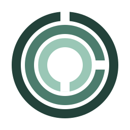
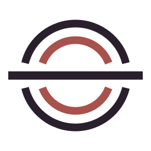
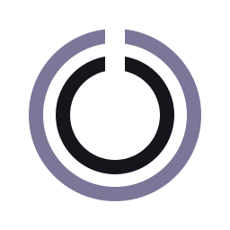

# Armin Azimi

### Building calm tools for noisy systems.

Software engineer · Open-source builder

### On the workbench

A few things I’m building for people and the agents they work with.

<h3><picture>
  <source media="(prefers-color-scheme: dark)" srcset="./assets/evergreen-mark-dark.svg">
  
</picture>&nbsp;<a href="https://github.com/arminazimi/evergreen">Evergreen</a> — Keep your stack evergreen.</h3>

Evergreen finds deprecated runtimes, packages, and GitHub Actions at exact locations, backs every finding with authoritative evidence, and prepares migration context for humans and agents. Scans stay offline—repository code never leaves the machine.

CLI · MCP server · GitHub Action · Agent Skill

<h3><picture>
  <source media="(prefers-color-scheme: dark)" srcset="./assets/seaworthy-mark-dark.svg">
  
</picture>&nbsp;<a href="https://github.com/arminazimi/seaworthy">Seaworthy</a> — Ship sites agents can trust.</h3>

A verification toolkit in development for built static sites, designed to give coding agents actionable findings with stable IDs, exact locations, and fix hints.

Pre-alpha · Static-site verification · Agent tooling

<h3><picture>
  <source media="(prefers-color-scheme: dark)" srcset="./assets/slipway-mark-dark.svg">
  
</picture>&nbsp;<a href="https://github.com/arminazimi/slipway">Slipway</a> — Build on Slipway. Ship Seaworthy.</h3>

A planned GitHub Pages template designed for agents, with Persian and Arabic RTL support, structured content, and Seaworthy verification.

Planning · GitHub Pages · RTL · Agent-native sites

<h3><picture>
  <source media="(prefers-color-scheme: dark)" srcset="./assets/oakum-mark-dark.svg">
  
</picture>&nbsp;<a href="https://github.com/arminazimi/oakum">Oakum</a> — Changes flow. State holds.</h3>

A planned local testing tool for checking application-state consistency across databases, caches, and message brokers through fault injection and reproducible failure replays.

Planning · State consistency · Fault injection · Reproducible failures

<h2 align="center"><em>If it can fail, it should explain why.</em></h2>

